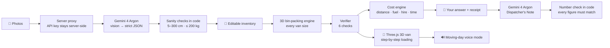

<div align="center">

# 🚚 VanPack 3D

### Which van do you need, and what will it really cost?

**Snap your stuff → Gemini 4 Argon measures it → code proves it fits → see it loaded in 3D.**

Built in one day at **Halloween at Imperial: Gemini Edition** (Google DeepMind × Imperial College London, 31 October 2026)
Track 2 · Multimodal & Human-Centric AI

[🎬 Demo video](PASTE_YOUTUBE_LINK) · [🌐 Live app](PASTE_PUBLISHED_LINK)

</div>

---

## 😩 The problem

Every year, millions of people in the UK move home, and in London people move flats more often than almost anywhere. They all face the same question:

> **"Which van do I need?"**

Most people guess by eye.
- **Too small** → a second trip: more time, more fuel, sometimes another hire day.
- **Too big** → paying for empty space.
- **Hidden costs** (fuel, insurance, congestion charge, helpers) are rarely added up until moving day.

No simple tool looks at *your* belongings and tells you, **with proof**, what fits and what it will cost.

## 💡 The solution

| Step | What happens | Who does it |
|---|---|---|
| **1. Your stuff** | Photograph your belongings, or load a demo move | You |
| **2. Measure** | Gemini 4 Argon identifies each item and estimates size, weight, fragility and confidence | 🤖 **Gemini proposes** |
| **3. Review** | Editable inventory. Low-confidence sizes are flagged, impossible sizes are blocked | 🧑 **You confirm** |
| **4. Pack & verify** | A 3D bin-packing engine tests every van size, then 6 independent checks verify each result | 🧮 **Code proves** |
| **5. Your move** | From/to postcodes, floors, helpers → a full, itemised cost | 🧮 Code |
| **6. Your answer** | "Book the Medium van": a 3D loading plan, a receipt and a checked summary | ✅ Decision |

### Core principle: **Gemini proposes · You confirm · Code proves**

Gemini does what it's best at: **seeing and explaining**. Every size, fit, overlap, weight, distance and price is **calculated and verified by deterministic code**, never guessed by the model.

---

## ✅ The six verifier checks

Each check appears in the app as an **INSPECTED ✓** or **REJECTED** stamp.

| # | Check | How it is tested |
|---|---|---|
| 01 | **Inside the van** | Every item's position + rotated size ≤ the van's internal dimensions |
| 02 | **No overlaps** | Pairwise axis-aligned bounding-box test with a 2 cm safety gap |
| 03 | **Stable support** | Every elevated item has ≥ 70% of its base supported |
| 04 | **Legal payload** | Total weight ≤ the van's maximum payload |
| 05 | **Fragile items safe** | Nothing is placed on top of fragile items |
| 06 | **Complete** | Every item is placed, or each leftover is listed with a plain-English reason |

A van is only recommended when **all six checks pass**. Failing vans explain why, e.g. *"Single Mattress 190 cm is longer than the Small van's 180 cm floor."*

---

## 💷 The cost engine (all deterministic)

| Line | Formula |
|---|---|
| Distance | postcodes.io lat/long → straight-line miles × 1.3 road factor |
| Trips | 1 if everything fits; otherwise re-pack the leftovers |
| Fuel | miles ÷ mpg × 4.546 L × diesel price |
| Hire | day rate × days (+15% at weekends) |
| Insurance | per-day excess waiver |
| Congestion Charge | added if the route enters the central London zone |
| Labour | loading + driving + unloading time × helper rate |

Every rate is editable and labelled as an example. The key insight it surfaces: **a cheaper van can cost more in total if it needs two trips.**

---

## 🏗️ Architecture



### Gemini models

| Model | Job | Why |
|---|---|---|
| `gemini-4-argon` | Detects items in photos and estimates real-world sizes using reference objects (doors ≈ 200 cm, UK mattress sizes, standard boxes) | Strong visual reasoning; returns structured JSON with confidence and reasoning |
| `gemini-4-argon` | Writes the Dispatcher's Note | Clear explanation, built only from verified numbers, then checked by code |
| Gemini text-to-speech | Moving-day voice mode, multiple languages | Hands-free guidance while loading; browser speech as a fallback |

### Tech stack
React · TypeScript · Vite · Three.js · Express (server-side Gemini proxy) · `@google/genai` · postcodes.io · Built with **Google AI Studio Build**

---

## 🎨 Design

Styled as a **removal company's paperwork**: warm paper, kraft-cardboard panels, stencil headings, hi-vis yellow actions and rubber-stamp verification. The 3D view shows a real panel van in cutaway with open rear doors and plywood-lined walls, loaded with recognisable items (taped boxes, a mattress, a sofa, a fridge-freezer, a blanket-wrapped TV). Items that don't fit are left on the pavement, marked **LEFT BEHIND** 👻.

---

## 🧪 Try it

1. Click **Small Studio Flat Move**.
2. Pack it: the **Small van ❌** (the mattress is 10 cm too long), the **Medium van ✅** (all 6 checks pass).
3. Open **Load Van** → **▶ Play loading**.
4. Add a move: **HA9 0WS → SE1 7PB** and see the full itemised cost.
5. Result: **book the Medium van**, cheaper overall than two trips in a Small van.

Or just press **▶ 60-SECOND TOUR**.

---

## 🚀 Run locally

**Requirements:** Node.js 18+ and a Gemini API key from [Google AI Studio](https://aistudio.google.com/apikey).

```bash
git clone https://github.com/HeinHtet-Phyo/vanpack-3d-gemini.git
cd vanpack-3d-gemini
npm install
echo "GEMINI_API_KEY=your_key_here" > .env
npm run dev
```

Open the local address shown in the terminal (usually http://localhost:3000).

> 🔒 `.env` is in `.gitignore`. Never commit API keys.
> No key? The demo moves, packing, verification, cost engine and 3D all work without Gemini.

---

## 🔭 What's next

- Live van-hire prices and booking, always with user confirmation
- Door, stairwell and lift-width checks: "will it even get out of the flat?"
- Real-time camera scanning and Gemini Live voice guidance on moving day
- House-share mode: shared vans, multi-trip plans and split costs

---

## 👤 Author

**Hein Htet Phyo**, BSc Data Science & AI (First Class Honours), UWE Bristol
GitHub: [@HeinHtet-Phyo](https://github.com/HeinHtet-Phyo)

*Built with Gemini 4 Argon and Google AI Studio at Halloween at Imperial: Gemini Edition.* 🎃
